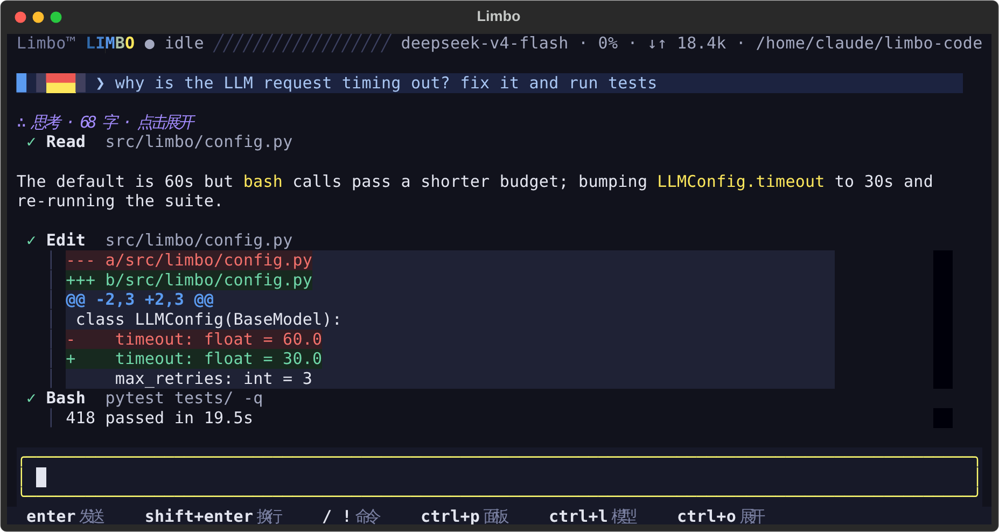
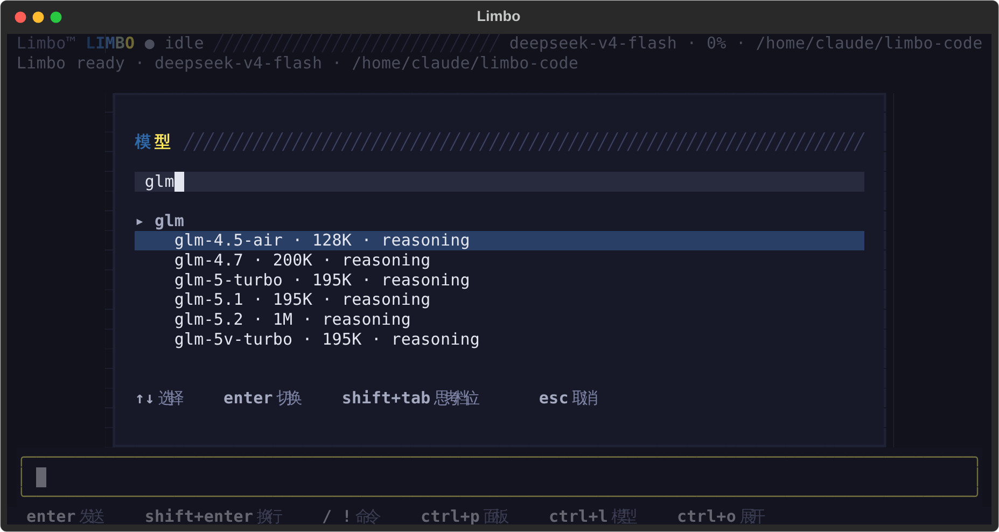

# Limbo

**A terminal AI coding agent that is small enough to understand and sturdy
enough to trust with long work.**

Tell Limbo what you want in plain language. It explores your repository, reads
and edits files, runs commands, and streams its reasoning and every tool call
as it goes. When the work runs long, Limbo keeps it safe: every turn is
journaled to disk, a crash or a closed terminal picks up where it stopped, and
you can branch, hand off, or replay any session.



## Who it's for

- **Developers who live in the terminal** and want an agent that fits next to
  their editor, multiplexer, and dotfiles instead of a separate app.
- **People who use more than one model.** DeepSeek, Kimi, GLM, OpenAI Codex, or
  any OpenAI-compatible endpoint, switchable mid-conversation.
- **Anyone who wants to see what the agent did.** Every request, tool call, and
  token is recorded and browsable; nothing happens off-screen.
- **Hackers who want to read the code.** Seven tools, one agent loop, plain
  JSONL on disk. `AGENTS.md` explains every design decision.

## What you get

### Work that survives

- **Durable sessions.** Messages, tool-call intents, queued follow-ups, and
  compactions are appended to a JSONL journal as they happen. Kill the process
  mid-turn and resume: read-only calls that were interrupted are re-run,
  calls that may have had side effects are flagged so the model checks before
  retrying, and nothing you queued is lost.
- **Resume, branch, hand off.** `limbo --continue` or `/sessions` to pick up,
  `/fork` to try another direction without touching the original, `/handoff`
  to start a clean context with a written brief that links back.
- **Long runs stay alive.** Automatic compaction summarizes old turns when the
  context fills up, while the full record stays in the journal.

### You stay in control

- **`/plan`** puts the agent in read-only mode: it explores and proposes a
  step-by-step plan, while writes, edits, and mutating shell commands are
  blocked until you say `/plan off`.
- **`/goal <task>`** closes the loop: the model proposes a verify command, you
  confirm it, and Limbo iterates until it passes.
- **Steer while it works.** Type while a turn is running to redirect it;
  `Alt+Enter` queues a follow-up for after the task; `Esc` interrupts.
- **Side channels.** `/btw <question>` asks something quick without polluting
  the history; `!<command>` runs a shell command yourself, never sent to the
  model.

### Any model, set up in seconds

- **Guided setup.** On first run with no key, Limbo asks for one and saves it
  to `~/.limbo/auth.json` (readable only by you). `limbo auth login` verifies a
  key against the provider before saving; `limbo models` lists the catalog and
  which models are ready to use.
- **Switch without restarting.** `Ctrl+L` (or `/model`) opens a searchable
  picker with recent models first. Pick a model whose provider has no key yet
  and it asks for one inline. `Shift+Tab` steps through thinking levels.
- **Three wire formats** (OpenAI completions, Anthropic messages, OpenAI
  responses) behind one catalog, with per-provider overrides for relays,
  renamed key variables, and extra headers.



### Fast turns

- Tool calls issued together run concurrently; edits to the same file are
  serialized.
- **Code Mode** (`/code-mode`) collapses the tool catalog into a single
  `run_code` tool: the model writes one Python program against a generated SDK,
  turning many round trips into one.

### Nothing hidden

- **`/tracing-viewer`** opens a local web page with a live view of every LLM
  request, tool call, and token count in the session.
- **`/export`** dumps the session as a full JSONL log (request bodies, usage,
  tool results, errors) or as readable Markdown.

### A TUI worth living in

- **Limbo Dusk**, the default theme, with `limbo-dark` and `limbo-light`
  alternatives, all checked for contrast.
- **Follows Omarchy.** On an Omarchy desktop Limbo picks up the system theme
  and switches live when you change it.
- **Limbo Motion.** Subtle animation that tells the story from unsettled to
  settled. Set `[ui] motion = "reduced"` or `"off"` if you prefer stillness
  (SSH sessions default to reduced).
- `Ctrl+P` command palette, image and file paste with `Ctrl+V`, collapsible
  tool output with `Ctrl+O`.

### Scriptable

`limbo --headless` gives the same agent as a line-oriented REPL, and
`limbo --json` prints one JSON event per line so scripts can drive it without
parsing the screen. Inside the [Herdr](https://herdr.dev) multiplexer, Limbo
reports its working, idle, and blocked state to the pane.

## Quick start

Requires Python 3.11 or later.

```bash
pip install limbo-code
cd ~/code/my-project
limbo                       # first run asks for an API key
```

Prefer to set up keys first:

```bash
limbo auth login            # choose a provider, paste a key, verified and saved
limbo auth list             # where each provider's key comes from
limbo models                # what you can run right now
limbo -m glm-4.7            # one run on a different model
limbo -m kimi-k3:high       # ...with a thinking level
```

Then just describe the task: *"find why the login test is flaky and fix it"*.

## Everyday use

| Key | Action |
|-----|--------|
| `Enter` / `Shift+Enter` | send / new line |
| `Alt+Enter` | queue a follow-up for after the current task |
| `Esc` | interrupt |
| `Ctrl+L` | model picker |
| `Shift+Tab` | cycle thinking level |
| `Ctrl+P` | command palette |
| `Ctrl+S` | sessions |
| `Ctrl+O` | expand or collapse tool output |

| Command | What it does |
|---------|--------------|
| `/model [name]` | switch model (picker when bare); persists to config |
| `/plan [on\|off]` | read-only mode: explore and propose, mutations blocked |
| `/goal <task>` | iterate until a confirmed verify command passes |
| `/code-mode [on\|off]` | one `run_code` tool: a Python program, many tool calls |
| `/btw <question>` | side question that stays out of history |
| `/compact` | compact the conversation now |
| `/sessions` `/new` | switch to a past session, or start fresh |
| `/fork [n]` | branch into a new session (optionally keep only the first n turns) |
| `/handoff <brief>` | clean context seeded with a brief, linked to this session |
| `/export [path]` | full JSONL log, or Markdown when the path ends in `.md` |
| `/tracing-viewer [id\|off]` | live trace of this session in your browser |
| `!<command>` | run a shell command yourself, outside the conversation |

From the shell: `limbo --continue` resumes the latest session for the current
directory, `limbo --resume <id-prefix>` resumes any session.

## Models and providers

| Provider | Wire format | Endpoint |
|----------|-------------|----------|
| `deepseek` | openai-completions | `https://api.deepseek.com/v1` |
| `moonshotai` (Kimi) | openai-completions | `https://api.moonshot.ai/v1` |
| `kimi-coding` | anthropic-messages | `https://api.kimi.com/coding` |
| `glm` (GLM Coding Plan) | openai-completions | `https://open.bigmodel.cn/api/coding/paas/v4` |
| `codex` (OpenAI Codex) | openai-responses | `https://api.openai.com/v1` (relay expected) |

Unknown model ids fall back to generic OpenAI-compatible defaults, and the
model picker can connect any OpenAI-compatible endpoint. Everything can also
live in `~/.limbo/config.toml`:

```toml
[llm]
model = "deepseek-v4-pro"           # endpoint and key variable come from the catalog

[providers.codex]                   # override one provider only
base_url = "https://my-relay.example.com/v1"
api_key_env = "CODEX_API_KEY"
headers = { x-relay = "on" }

[ui]
theme = "auto"                      # Omarchy if installed, else limbo-dusk
motion = "full"                     # full | reduced | off
```

## Make it yours

- **Project instructions.** Limbo reads `AGENTS.md` from the working directory
  and `~/.limbo/AGENTS.md` into its system prompt.
- **Skills.** Drop a `SKILL.md` into `<project>/.agents/skills/<name>/` or
  `~/.limbo/skills/<name>/`. The model loads it when the task matches, or you
  call it as `/<name>`. See [docs/skills.md](docs/skills.md).

## Safety

**There are no fences.** Tools run immediately and unconfined: file tools
honor absolute paths and symlinks anywhere, there is no sensitive-file
blocklist, and `bash` runs every command as written, `rm -rf` included. Use
`/plan` when you only want the agent to look, run Limbo with trusted models,
and keep it in repositories you can afford to modify or lose.

```toml
[tools]
bash_enabled = false     # if you need a hard stop
```

## Development

```bash
uv sync        # dev tools are a PEP 735 group, installed by default
make check     # sync + tests + lint + typecheck
```

Individually, always `python -m pytest`, never `uv run pytest` (which can fall
through to a global pytest on `PATH`):

```bash
uv run python -m pytest tests/ -v
uv run ruff check src tests
uv run mypy src
```

The screenshot above is rendered from the real UI by
`scripts/readme_hero.py` (`uv run python scripts/readme_hero.py`), so it can't
drift from what ships.

## Learn more

- [`AGENTS.md`](AGENTS.md): architecture and design decisions
- [`CONTEXT.md`](CONTEXT.md): domain glossary
- [`docs/session-management.md`](docs/session-management.md): sessions,
  recovery, fork and handoff, tracing viewer
- [`docs/skills.md`](docs/skills.md): writing skills
- [`design/`](design/): RFCs for headless mode, bang commands, and the UI
